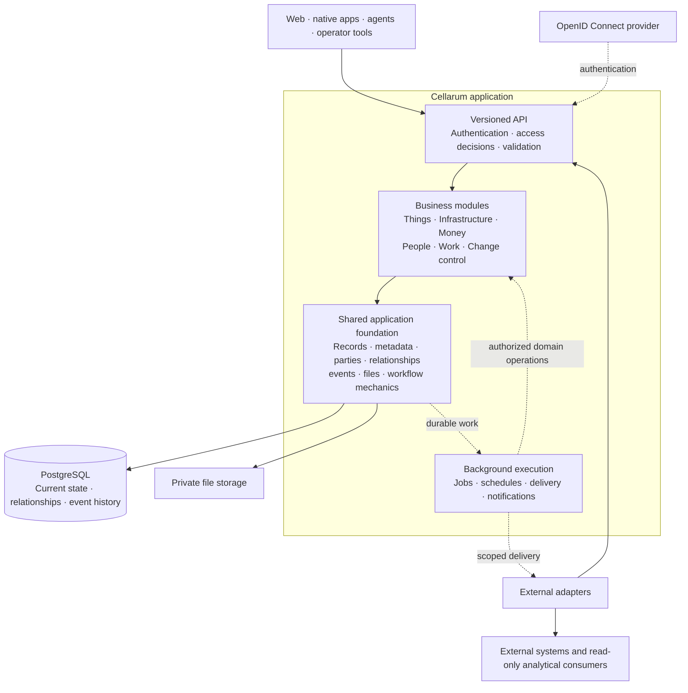

# Cellarum platform architecture

This is the platform-wide architecture and delivery plan for Cellarum. It covers
the shared application foundation, business modules, ownership boundaries,
products, clients, integrations and deployment targets across the organization.
Component repositories own their implementation contracts, migrations and tests;
this document owns how those components fit together.

Cellarum is in development. Statements marked as requirements or proposals describe
the intended design, not a claim that a complete product or deployment exists.
The initial planning baseline is October 2026. Implementation status must be
established from component source and acceptance evidence before release.

## 1. Purpose and scope

Cellarum holds operational records and runs the work attached to them: what an
organization has, where it is, who is responsible, what depends on it, what it
costs, what needs to happen and what changed. Inventory, infrastructure, stores,
procurement, enterprise resource planning and service management grow on one
shared foundation. That breadth is intentional.

An asset, party, location or commercial record keeps its identity across products.
A purchase can create stock or assets; a request can reference them; a change can
affect their dependencies. Those are connected records with a shared history,
not separate product inventories that need reconciling.

The architecture must support:

- Web, native, agent and operator experiences using one versioned API.
- Departments operating independently within explicit access boundaries.
- Shared application capabilities that make each business module cheaper to add.
- Configuration and deployment on self-hosted Docker, Azure and AWS.
- Optional integrations with explicit authority, provenance and recovery behavior.
- Incremental replacement of existing operations after reconciliation and acceptance.

## 2. Four concepts

| Concept | Responsibility | Examples |
| --- | --- | --- |
| Framework/kernel | Reusable application machinery, contracts and client components | Field definitions, access decisions, events, files, approval mechanics, jobs |
| Module | A business capability with owned records, invariants and transitions | Things, Infrastructure, Money, People, Work, Change control |
| Workspace | Proposed product vocabulary for the existing departmental Domain ownership/access boundary | Two departments using procurement with separately authorized records |
| Product | A coherent experience assembled from module capabilities | Inventory, Stores, ERP, service management, Status |

These are independent dimensions. A person may use several products across their
authorized workspaces. A module may serve several products. A product may combine
several modules. None of those combinations creates another copy of the records.

Workspace terminology remains proposed. Existing Domain identifiers, API fields,
routes and access semantics remain unchanged until a separate change is approved.
A workspace is not evidence of independent organization/tenant isolation.

In architecture, module means a business capability. UI navigation groups such as
Devices or Systems are collections or areas; persisted classes determine record
types. Existing navigation labels and the backend module contract need an explicit
mapping rather than an assumption that they are the same concept.

## 3. Platform structure

This diagram describes intended responsibilities, not deployment or completion
status. Products are compositions of capabilities, not additional services.

The core is a modular application, with separately runnable workers as needed.
Shared capabilities do not require a new service or framework repository. The API
owns server contracts and business enforcement; each client owns its presentation
components and platform conventions. Clients do not import backend models or
write directly to operational storage.

### Repository responsibilities

| Repository | Owns | Coordination boundary |
| --- | --- | --- |
| `.github` | This architecture, organization profile, documentation index and brand assets | Cross-repository vocabulary, ownership and architecture decisions |
| `cellarum-api` | FastAPI application, OpenAPI, domain services, shared kernel, PostgreSQL schema, migrations and worker behavior | Authoritative operations, permissions, transactions and versioned contracts |
| `cellarum-app-web` | Next.js/React web application and reusable web presentation | Typed API consumption, accessible interactions and product navigation |
| `cellarum-app-swift` | Native Swift/SwiftUI experience | Native workflows over the same API and authentication contract |
| `cellarum-app-csharp` | Native C#/WinUI experience | Native workflows over the same API and authentication contract |
| `cellarum-mcp` | Agent tools over the HTTP API | Scoped principals, bounded reads and explicit action semantics |
| `selfhosted-docker-cellarum` | Compose installation and upgrade composition | Compatible images, local services, secrets inputs and recovery |
| `terraform-azurerm-cellarum` | Reusable Azure infrastructure | Declared hosting, storage, networking, identity and observability |
| `terraform-aws-cellarum` | Reusable AWS infrastructure | Declared hosting, storage, networking, identity and observability |

An operator CLI is a planned API client. Integration adapters remain outside the
core; their repository and packaging follow the adapter's lifecycle. Product
names do not automatically create new repositories or deployments.

## 4. Shared application foundation

The framework includes kernel services and reusable client machinery. Build it
through complete workflows, extracting common behavior when a second consumer
proves that the abstraction is useful. Existing field, access, event, document,
notification and UI foundations should be audited and extended before replacement.

| Capability | Shared responsibility | Business-specific responsibility |
| --- | --- | --- |
| Records and metadata | Stable IDs, typed field profiles, validation, relationships and API conventions | Which records and invariants a capability needs |
| Forms, lists and views | Field rendering, columns, filters, saved views, actions and bulk-operation presentation | Specialized screens, required evidence and meaningful business actions |
| Access | Authentication, scoped grants, target/action decisions and explanations | Business authorization and separation-of-duty rules |
| History | Atomic state/events, exact replay, provenance and authorized historical reads | Event meaning and valid transitions |
| Tasks and approvals | Assignment, decisions, delegation, deadlines and evidence mechanics | Who may approve, under which conditions, with what effect |
| Files and documents | Authorized references, storage, revisions, templates, rendering, numbering and retention mechanics | Required content, issuance, numbering policy and legal/fiscal meaning |
| Jobs and notifications | Durable scheduling, leases, retries, deduplication, dispatch and failure visibility | When to act, who to notify and what action is authorized |
| Integration support | Stable source IDs, observations, proposals, delivery and reconciliation contracts | Which system owns each fact and may change it |
| Operations | Compatibility, health, telemetry, upgrades, backup/restore and deployment interfaces | Product-specific acceptance and operating budgets |

### Metadata and reusable UI

Use descriptive, versioned metadata for configurable fields, groups, list columns,
filter operators, references and supported actions. Keep relational structures and
database constraints for references, quantities, capacity, money and workflow
integrity. Configurable fields do not require dynamic schema changes.

Metadata is scoped before disclosure. It does not carry executable scripts, SQL
or client-side permission rules. A saved view stores a bounded query definition;
running it rechecks current authorization. Exports follow the same selection and
visibility policy. Unknown capabilities and schema versions need explicit client
fallbacks that do not silently lose required information.

Web components reuse field, list, filter and action semantics. Native clients use
native controls for those same semantics. Rack elevations, physical maps and
other specialized views remain purpose-built experiences over shared records.

### Workflow mechanics

Shared tasks and approvals must support versioned definitions, assigned actors,
decisions, delegation, deadlines, evidence, cancellation and idempotency. Running
instances retain the definition and policy under which they started. Taking an
action rechecks current authority and relevant record versions.

The business module owns its transitions and effects. Spending authorization is
Money; stock availability is Things; request queues are Work; external estate
changes are Change control. A reusable approval does not turn every internal task
into an external change record. State changes, evidence and resulting business
effects need an explicitly defined transaction boundary.

### Files, output and background execution

Private files have authorized references, revisions, size/type limits, retention
and storage drivers. A content hash or storage key never grants access. Issued
documents retain their source snapshot, template version, issuer and immutable
bytes; correction uses explicit voiding or supersession. A shared numbering
mechanism does not decide business numbering rules.

Jobs need atomic enqueue/outbox behavior, leases, acknowledgements, retry/backoff,
deduplication, cancellation and dead letters. Event history alone is not a work
queue. At-least-once delivery requires idempotent handlers; external effects are
not promised to occur exactly once. Schedules define timezone and missed-run
behavior. Workers preserve the same domain rules, Writer and access checks.

Queued notifications and exports must not bypass removed access. Recheck the
execution principal and recipient authority at execution or delivery. Logs and
failure views require their own visibility rules. Backup/restore verifies file
bytes, job state and references as well as database records; replay does not
recreate external files or repeat external side effects.

## 5. Business modules

Keep the existing six backend modules. A capability such as Procurement or
Accounting can have its own internal structure and acceptance within Money;
creating another top-level module requires an explicit ownership decision.

| Module | Intended business responsibility | Boundary |
| --- | --- | --- |
| Things | Holdings, stock, lending, audits, maintenance and fulfillment | Owns availability and movement; uses commercial references without duplicating them |
| Infrastructure | Compute/services, dependencies, physical topology and placement | Separates recorded/observed connectivity from intent and live-system authority |
| Money | Catalog commerce, procurement, financial approvals, obligations and operational reconciliation | Owns purchase authorization and commercial aggregates; accounting expansion requires its own rules |
| People | Responsibilities, memberships and links to shared parties | Does not become the directory or identity provisioning authority |
| Work | Requests, tasks, queues and operational workflow experiences | Owns service work; supplies shared eligibility/task facts through explicit composition |
| Change control | Plans, review, apply receipts, verification and recovery context | Owns controlled external changes; verification requires observed evidence |

The table gives architectural direction, not an instruction to move existing
tables. Current implementations can assign particular leasing or deployment
workflows to Work. Before changing that ownership, document the record owner,
transition owner, transaction boundary and compatibility plan.

The kernel never imports module implementations. Modules declare their kernel
dependencies and do not directly import one another. Composition owns wiring;
cross-module behavior uses explicit kernel contracts and events. Operations that
require atomic consistency must retain it through a reviewed composition boundary
rather than relying on eventual delivery for integrity.

Full accounting remains a deliberate future capability. Its plan must cover chart
of accounts, balanced postings, fiscal periods, closing, reversals, reconciliation,
tax/localization and financial access. Operational amounts and purchase records
do not establish an implemented ledger. Existing external authority remains until
the replacement is accepted and reconciled.

## 6. Workspaces, access and identity

Workspace is proposed as the user-facing name for the current Domain boundary.
One organization can have several such boundaries while sharing permitted parties,
catalog references and locations. Cross-workspace relationships are explicit and
authorized; they do not grant blanket access to the other workspace.

Access must be enforced consistently across records, fields, actions, related
objects, search, counts, graphs, files, history, exports and background work.
Filter before matching; inaccessible and absent records must not be distinguishable
through discovery. Sign-in identity, module availability, product inclusion and
record permission are separate decisions. Neither navigation nor a product host
name grants authority.

Before any terminology change, inventory labels, API consumers, keys/grants,
events, exports, configuration and documentation. A UI rename may retain Domain
routes, fields and IDs. A later API/database rename needs a separate reviewed
compatibility, deprecation, generated-client, replay and recovery plan.
Transferring a record between workspaces is an audited operation subject to both
sides' rules, not a label edit.

OIDC supplies authenticated principals; Cellarum owns application authorization.
Directory lifecycle and provisioning remain with the deployment's designated
identity authority. Agent and integration credentials are scoped, attributable
and revocable. A shared MCP process must not be presented as individual-user
authorization unless that identity propagation is actually implemented.

## 7. Products and client experiences

| Product direction | Capability composition | Acceptance example |
| --- | --- | --- |
| Inventory | Things, Infrastructure, People and Work | Locate, assign, move, audit and trace a holding with one history |
| Stores | Things, Money, People and Work | Request, approve, reserve, purchase, fulfill and return without duplicate stock |
| ERP | Money, People and Work, with Things for inventory/assets/receiving | Trace authorization through receipt and reconciliation; introduce accounting through its own acceptance gate |
| Service management | Work, People, Things, Infrastructure and Change control | Resolve a request tied to affected assets/services and record the authorized outcome |
| Status | An explicitly published subset of Infrastructure and Work | Show approved service status without disclosing protected operational topology |

Products define audiences, navigation, supported tasks and required capabilities.
Availability is the intersection of configured capabilities and current access.
Commercial store requests can belong to Money while fulfillment belongs to Things;
that does not make Stores a new backend module. Work can supply intake eligibility
without owning the commercial record.

Public catalogs, self-service and published status require explicit publication
and requester policies. Own-only requester operations do not grant general
inventory roles. A portal is another experience over authorized contracts, not a
parallel record system.

Web, native and agent support is tracked per workflow. Generated types reduce
contract drift but do not establish complete client parity. Native apps retain
platform conventions; agent mutations need explicit actions, scoped actors,
concurrency preconditions and reviewable results. Offline writes require a
separate conflict and reconciliation design before they are offered.

## 8. Integrations and data authority

Every external fact has a source, stable external identity, observation time,
freshness and authority. Distinguish stewarded decisions, declared intent and
observed state. An observation must not silently overwrite a stewarded fact.
Unknown remains unknown; conflicts become explicit reconciliation work.

Adapters use the public API with scoped credentials. Vendor logic and credentials
stay outside the kernel. Each adapter defines field authority, resumable reads,
reconciliation, retry-safe writes, a dry run and a disable control. External writes
record intent, approval, receipts, verification and compensation where supported.
Sending a request is not verification.

Where desired configuration lives in Git, propose a reviewed change through that
repository's deployment path. Where a system owns its API, use an explicit adapter
contract. A read-only source stays read-only. Integrations do not invent another
identity authority or bypass the target's control plane.

Operational reports that drive action belong in Cellarum. Analytical consumers
receive authorized, versioned snapshots/events with explicit grain, completeness
and delivery semantics. They do not become an operational write path, and Cellarum
must remain operable and recoverable without an analytical consumer.

## 9. Hosting, release and recovery

Docker, Azure and AWS use the same application contracts and compatible container
artifacts. Provider-specific deployment components may differ; business behavior
and authorization must not fork by host. File, job and secret interfaces need
tested implementations for each supported target.

Deployable resources, identity configuration, permissions, networking, storage,
schedules and monitoring belong in Terraform or the established reviewed IaC path.
Provider choices and institution-specific inputs remain with deployment owners.
Secrets are references or deployment inputs, never operational records or committed
examples. Manual recovery changes must be reconciled into code.

Each release defines API/client compatibility, migration order, old/new worker
compatibility, versioned images, rollback limitations and backup/restore evidence.
Coordinate migrations before multiple replicas depend on the changed schema.
Health, delivery lag, job failures, bounded queries and storage recovery are part
of acceptance. Support claims require verification for the actual target, not just
a scaffold or a successful build.

## 10. Development status and evidence

| Area | Planning baseline | Evidence still required for a complete release |
| --- | --- | --- |
| API/kernel | Shared records, access, events/replay and several operational workflows exist; services have mixed maturity | Per-capability contract, permission, concurrency, recovery and rollout acceptance |
| Web | Operational views and reusable editing/field/filter foundations exist | Workflow completeness, authentication, accessibility, responsive behavior and API compatibility |
| Native clients | API-client foundations/scaffolds; complete technician experiences remain planned | Real sign-in, generated-contract compatibility and accepted native workflows |
| MCP | Read-only tools over the API exist | Per-principal access, bounded output, client lifecycle and separate acceptance for any mutations |
| Commercial and service modules | Partial implementations alongside planned capabilities | End-to-end reconciliation and explicit ownership; no assumption of a complete ERP/service desk |
| Files and background work | Specific document/email/delivery foundations exist | General private attachments, durable execution and recovery across targets |
| Hosting | Compose is the working self-hosted composition; cloud components are evolving | Reproducible deployment, identity, upgrade and restore evidence per target |

Refresh this matrix through linked implementation issues. Development status,
deployment enablement, product inclusion and actor permission must be represented
separately. Older documentation and repository presence are not completion proof.

### Framework delivery evidence

The [platform audit](https://github.com/cellarum/.github/issues/20) coordinates
component work. The first shared record slice uses Department and Supplier as
two real consumers; it does not replace their business operations with a generic
mutation service. The following evidence describes source delivery, not deployment
enablement or complete product acceptance.

| Slice | Owning evidence | Accepted scope and remaining boundary |
| --- | --- | --- |
| Shared ordinary-record presentation | [Web fields/actions](https://github.com/cellarum/cellarum-app-web/pull/314), [reference controls](https://github.com/cellarum/cellarum-app-web/pull/316) | Reusable serializable fields, native typed writes and paged reference recovery; these client foundations alone do not establish server-owned metadata |
| Scoped record definitions | [API contract](https://github.com/cellarum/cellarum-api/pull/281), [client acceptance](https://github.com/cellarum/cellarum-app-web/issues/318), [contract issue](https://github.com/cellarum/cellarum-api/issues/276) | Version 1 describes bounded Department/Supplier fields and their existing update action; actor/Site-scoped, uncached and descriptive, with native authorization and If-Match retained. Client adoption is tracked separately from the merged server contract |
| Shared location references | [API filter](https://github.com/cellarum/cellarum-api/pull/278), [web adoption](https://github.com/cellarum/cellarum-app-web/issues/318) | Native shared-only filtering precedes matching, counts and paging; client-side filtering of a mixed page is not an equivalent fallback |
| Private files and document execution | [Classified files](https://github.com/cellarum/cellarum-api/issues/67), [asset attachments](https://github.com/cellarum/cellarum-api/issues/117), [durable execution proposal](https://github.com/cellarum/cellarum-api/issues/277) | Existing document and delivery implementations remain owned by their components. General attachments and crash-safe application jobs require their own access, retention and recovery acceptance |
| Native client acceptance | [Swift workflows](https://github.com/cellarum/cellarum-app-swift/issues/3), [C# workflows](https://github.com/cellarum/cellarum-app-csharp/issues/3) | Sign-in, generated-contract compatibility and actual native workflows remain explicit acceptance work; shared metadata does not establish native parity |

The metadata package remains partial until two record families cover forms,
lists and actions with consistent server-owned semantics and tested fallbacks.
The first record definition contract covers forms and the native update action;
it does not declare list columns, query/filter operators, create/delete authority,
saved views, bulk operations or business approvals. Existing specialized controls
and routes retain their contracts. Extend this bounded contract only through a
reviewed proposal with typed client compatibility and access tests.

For the next shared-service proposal, Money payment-voucher rendering and Work
user-agreement generation are the candidate pair. They already share rendering
and private byte storage while owning distinct finalization rules. Admission,
frozen inputs, execution authority, fencing, source versions, immutable output,
replay and database/file restore must be specified before introducing persisted
jobs. Render completion is separate from business issuance and external delivery.
This proposal reserves no migration and changes no current synchronous response.

## 11. Delivery plan

Existing operational delivery continues. These work packages organize shared
platform development without restarting completed work or reserving migrations.

| Order | Work package | Exit criterion |
| --- | --- | --- |
| 1 | Cross-repository capability and ownership audit | Evidence matrix across API, web, native, MCP and hosting; each gap has an owner, dependencies and an implementation issue |
| 2 | Metadata and shared action contracts | Two record families use consistent forms/lists/actions with server-owned rules, scoped metadata and defined client fallbacks |
| 3 | Files, documents, jobs and notifications | Private access, crash/retry recovery, idempotency, delivery visibility and database/file restore are proven |
| 4 | Shared task/approval mechanics | Two real workflows reuse mechanics while retaining their distinct business authorization and transitions |
| 5 | Cross-module purchase/fulfillment slice | Request → approve → order → partial receipt → assets/stock → fulfill/return reconciles quantities, amounts, ownership and history |
| 6 | Workspace and product composition | A second workspace operates through configuration; products share record IDs and preserve restricted visibility; terminology changes have their own approval |
| 7 | ERP and service-management expansion | Each capability has an explicit business boundary, accepted workflows and reconciled authority; accounting has its own posting/closing/recovery gate |

Packages can overlap when dependencies permit. Prove reuse with a second flow
such as lending or maintenance, not two copies of one purchase screen. Start with
API/web acceptance, then track native and agent delivery against their actual
capabilities rather than promising simultaneous completion.

Every implementation issue identifies repository ownership, contract/client
changes, migration requirements, fictional fixtures, access rules, concurrency,
replay, performance budgets and rollout boundary. Test partial failure, repeated
requests, removed access, conflicting edits, receiving/return reversals and restore.
Do not use production or retained operational data as a test fixture.

## 12. Documentation and change ownership

This file is the canonical cross-repository architecture. Component documentation
links here and owns the details specific to that component. Keep one architecture
source rather than copying this plan into every repository.

Platform changes that alter ownership, terminology, shared contracts, product
composition or hosting assumptions update this document through a reviewed pull
request. Component-only changes update the relevant component. An implementation
plan names the affected repositories and coordinates their owners before editing
shared interfaces or reserving migrations.

The immediate work is the cross-repository capability audit and small implementation
issues for the first shared workflow. Workspace terminology, a dedicated approval
service, native/offline scope, accounting release boundaries and supported hosting
acceptance remain explicit decisions, not consequences of publishing this document.

Public architecture uses fictional examples and product-generic requirements.
Deployment inventories, credentials, institutional mappings, private operations
and rollout evidence stay in the deployment owner's systems of record.
