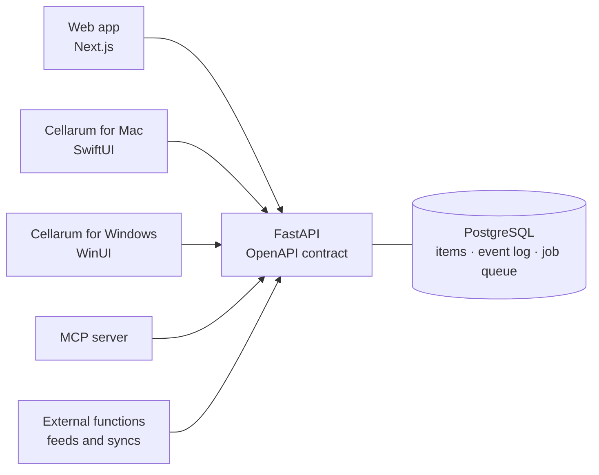

# Cellarum — everything you have, connected

Cellarum (SEL-ər-əm) means “of the storerooms” in Latin. The name carries that tradition of keeping things organized, accounted for, and ready when needed.

Cellarum brings your devices, servers, networking, stock, purchases, and contracts into one shared record. Each asset has a place in the bigger picture: where it is, who it belongs to, what it connects to, and where it stands in its lifecycle. Departments maintain their own inventories, while authorized teams can follow relationships across the organization.

Floor plans, rack layouts, and dependency views connect physical assets to the applications and services they support. Inventories, stores, and warehouses run on the same engine, accessible through a web app, native apps, an API, and an MCP server.

**In early development.** The repositories are private until the first release.

## Product scope

Cellarum is being built as a complete infrastructure inventory and asset-management platform. The scope includes the operational workflows of an established asset system alongside detailed networking and server inventory. Features below are the product direction; early development does not mean every subsystem is available yet.

- **Devices and asset management**: computers, phones, printers, accessories, components and licence seats, with assignment, checkout and checkin, audits, maintenance, files and labels
- **Networking**: ONTs, wall jacks, patch panels, switches and Wi-Fi access points, including ceiling-mounted equipment. Named ports and their connections make a path traceable through the physical network
- **Servers and services**: physical servers, hypervisors, VMs and cloud instances, with compute and storage details, host/guest relationships, ownership, backup and monitoring context, and application dependencies
- **Physical inventory**: buildings, rooms, communications closets, racks and placements, connected through floor plans and rack elevations. Explicit asset locations determine placement, even when a device name reflects an old location; updated plans and incomplete mappings need clear review paths
- **Lifecycle and support**: purchases, warranties, leases, support and end-of-life dates, with firmware information for network equipment and renewal records for websites, certificates and contracts
- **Stock, procurement and stores**: counted consumables, supplier catalogs, requisitions, purchase orders and budgets, with departmental stores and loans on the same engine
- **Controlled visibility**: departmental inventories and role-based access, with sensitive topology protected across maps, relationships, search, exports and the API
- **Trustworthy records**: an event for every change, clear data provenance and freshness, and migration tools that reconcile missing assets and conflicting facts

Assets are received, assigned, moved, loaned, counted, renewed and retired through the same API. History records who changed what, when and why.

## Architecture

The API is the product. Every app is a thin client with no database access.

FastAPI serves a typed OpenAPI contract written before the implementation. Vendor feeds and syncs run outside the core as API clients. Deployment targets are Terraform-managed Azure and AWS, plus self-hosted Docker Compose.

Sign-in goes through any OpenID Connect provider, Microsoft Entra first. Files live on object storage by default, or on a local disk.

## Repositories

| | Repo | Stack | License | |
|---|---|---|---|---|
| Server | `cellarum-api` | Python · FastAPI | AGPL-3.0 | The API core and its OpenAPI contract |
| Server | `cellarum-app-web` | TypeScript · Next.js | AGPL-3.0 | Web app for staff and the stores |
| App | `cellarum-app-swift` | Swift · SwiftUI | MIT | Cellarum for Mac |
| App | `cellarum-app-csharp` | C# · WinUI | MIT | Cellarum for Windows |
| Tooling | `cellarum-mcp` | Python · FastMCP | AGPL-3.0 | Your inventory for AI agents |
| Deploy | `terraform-azurerm-cellarum` | HCL | MIT | Azure infrastructure module |
| Deploy | `terraform-aws-cellarum` | HCL | MIT | AWS infrastructure module |
| Deploy | `selfhosted-docker-cellarum` | Docker | MIT | Compose stack for one server |

## Open core

The **server** (API and web app) and the **MCP server** are **AGPL-3.0**; the **native apps**, **Terraform modules** and **deployment tooling** are **MIT**. A separate commercial license is available for organizations whose policies do not permit AGPL.
