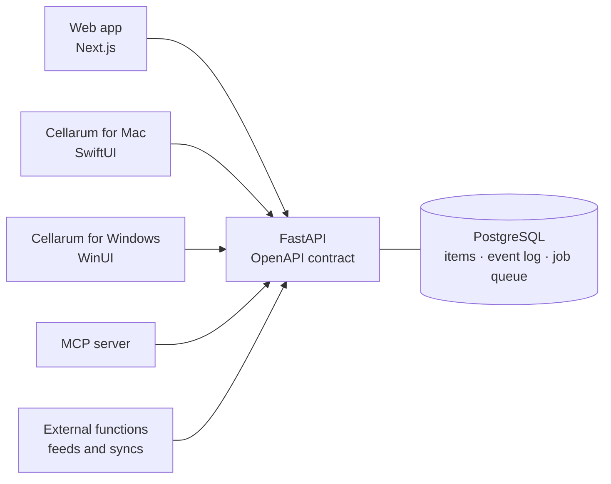

# Cellarum - the source of truth for what we hold and own

*Cellarum* (SEL-ər-əm): Latin for "of the storerooms". The cellarer kept a house's stores and bought what they needed.

One system of record for everything an organization owns, stocks, buys, and signs: **assets, consumables, purchases and contracts**.
Cellarum is the engine underneath: inventory, stores, warehouses and every department's own stock run on it, through an API, a web app, native apps and an MCP server.

**In early development.** The repositories are private until the first release.

## What it does

Cellarum is the operational layer: the place where things are received, assigned, moved, loaned, counted, renewed and retired. Every change is recorded as an event, so the record says who changed what, when and why.

- **Every asset class**: laptops and phones, servers and VMs placed on rack maps, network jacks placed on floor plans, websites, licences and contracts, in one model
- **Stock and consumables**: structural assets tracked one by one, and stock that is counted, with loans and stores on top
- **Procurement**: supplier catalogs, requisitions, purchase orders and budgets, from quote to delivered asset
- **Department domains**: each department runs its own inventory and sees only its own, on one shared platform
- **REST API**: FastAPI with the OpenAPI contract written first; every client is generated from it
- **Integrations outside the core**: feeds and syncs run as external functions against the API, so the core stays to itself
- **Multi-cloud**: Terraform for Azure and AWS, or self-host with Docker Compose

## Architecture

The API is the product. Every app is a thin client with no database access.

Sign-in goes through any OpenID Connect provider, Microsoft Entra first. Files live on object storage by default, or on a local disk.

## Repositories

| | Repo | Stack | License | |
|---|---|---|---|---|
| Server | `cellarum-api` | Python · FastAPI | AGPL-3.0 | The API core and its OpenAPI contract |
| Server | `cellarum-app-web` | TypeScript · Next.js | AGPL-3.0 | Web app for staff and the stores |
| App | `cellarum-app-swift` | Swift · SwiftUI | MIT | Cellarum for Mac |
| App | `cellarum-app-csharp` | C# · WinUI | MIT | Cellarum for Windows |
| Tooling | `cellarum-mcp` | Python · FastMCP | AGPL-3.0 | Your inventory for AI agents |
| Deploy | `terraform-azurerm-cellarum` | HCL | MIT | Azure infrastructure module |
| Deploy | `terraform-aws-cellarum` | HCL | MIT | AWS infrastructure module |
| Deploy | `selfhosted-docker-cellarum` | Docker | MIT | Compose stack for one server |

## Open core

The **server** (API and web app) and the **MCP server** are **AGPL-3.0**; the **native apps**, **Terraform modules** and **deployment tooling** are **MIT**. A separate commercial license is available for organizations whose policies do not permit AGPL.
